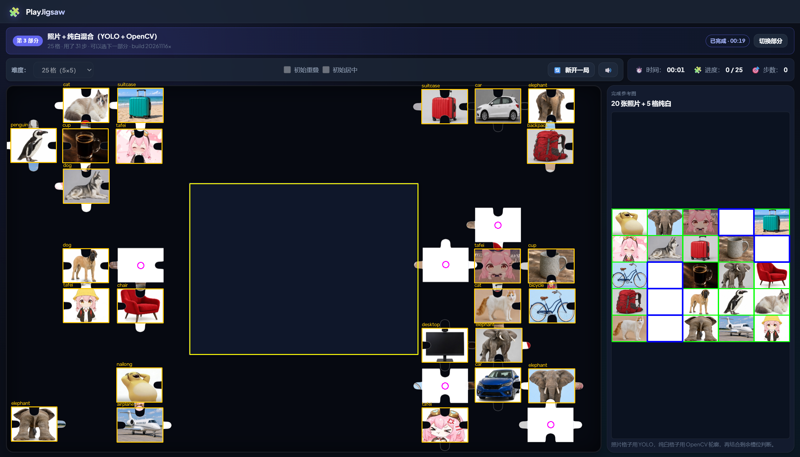

# 拼图视觉考核自动化（PART 3 混合模式 + 5×5）

用 **YOLO 识别屏幕** + **OpenCV 处理像素** + **代码控制真实鼠标**，自动完成网页拼图考核的
**第 3 部分「照片 + 纯白混合」、25 格（5×5）** 难度。

实测成绩（本机多局）：**25/25 拼完、11~12 秒、总步数 25~28**（理论下限 25 步）。

> 思路和常见做法不同：**白块不逐个试**，而是先拼 20 个照片格，再从盘面读出每个白格
> 需要的边形状，按形状把白块直接放上去。见 §4。

---

## 1. 环境

| 项 | 值 |
|---|---|
| 系统 | Windows 11，单屏 2560×1600，浏览器全屏（无地址栏） |
| Python | 3.11 |
| 主要依赖 | `ultralytics`、`opencv-python`、`numpy`、`mss`、`pyautogui` |
| 模型推理 | NVIDIA RTX 5060 Laptop（torch 2.11 + CUDA 12.8），YOLO11s 单帧约 0.1~0.3 秒 |

```bat
pip install ultralytics opencv-python numpy mss pyautogui
```

> 主程序直接 `import ultralytics` 在进程内跑推理，不需要额外的 HTTP 服务。

---

## 2. 快速开始

```bat
:: 1) 浏览器打开考核站，停在开始面板（第 3 部分 + 25 格）
:: 2) 启动程序
python demo_solve_last.py

:: 3) 按 F8 —— 程序会自己点「开始这一部分」、等棋盘生成、识别、然后逐个拖拽
```

运行时**只在控制台打印进度**，不生成任何文件。典型输出：

```
识别完成：照片块 25、白格 5、白块 5
阶段一：先拼 20 个照片格（白格留空）
  ✔ r0c0 ← photo15
  ...
阶段一结束：已拼 20 格，拖拽 20 次
阶段二：读盘面，白格需求形状如下
  r0c2  {'top': 'flat', 'right': 'tab', 'bottom': 'tab', 'left': 'tab'}
  ...
  形状匹配完成，总代价 1.905
  ✔ r4c4 ← 白块2 （按形状直放）
  ...
✔ 检测到完成弹窗：25/25 全部拼完（共拖拽 26 次）
```

其它参数：

```bat
python demo_solve_last.py --selftest             :: 合成图自检（不需要游戏和 GPU）
python demo_solve_last.py --selftest --all       :: 8 个难度递增的场景
python demo_solve_last.py --selftest --eval 200  :: 随机压测 200 局
python demo_solve_last.py --board 截图.png        :: 只看一张截图的形状分析
```

- 等待或拖拽过程中按一次 **F8** 可中断
- 控制台 **Ctrl+C** 强制结束

---

## 3. 目录

```
.
├─ demo_solve_last.py         主程序（识别 + 配对 + 拖拽，单文件）
├─ models\best.pt        训练好的 YOLO11s 检测模型（15 类）
├─ dataset\              训练数据集（750 张场景图 + YOLO 标注 + data.yaml）
│   ├─ data.yaml
│   ├─ images\{train,val}
│   └─ labels\{train,val}
├─ demo\演示视频.mp4      演示视频
└─ docs\detect.png       README 用的识别标注图
```

---

## 4. 算法流程

```
截图（mss）
  ├─ ① 标定：板区按底色图像找 → 参考网格用 YOLO 检出的 114×86 框做晶格拟合
  │          → 拟合不成立时回退到"板区 + 固定偏移"
  ├─ ② YOLO 一次推理，同时得到
  │       · 25 个照片块的位置 + 类别（块面 146×109）
  │       · 参考图 20 格的类别（没有检出的格 = 白格）
  ├─ ③ OpenCV 补两块信息
  │       · 白格：整格纯白占比 ≥ 0.98 且灰度 std < 2
  │       · 白块：纯白掩膜腐蚀分离 + 三道过滤（见 §6）
  ├─ ④ 阶段一：只拼照片格（外圈→内圈），白格先空着
  └─ ⑤ 阶段二：再截一张图，读盘面 → 按形状把白块直接放上去
```

### 白块为什么能"直接放"（本项目的核心）

照片块全部落位后，每个白格四条边要什么形状，**可以从盘面直接读出来**：

| 这条边的情况 | 结论 |
|---|---|
| 在盘面边界上 | **平边** |
| 相邻格已拼，它的凸起伸进了这个空格 | 需要**凹口** |
| 相邻格已拼，没有凸起 | 需要**凸起**（盘面内部的边不会是平边） |

同时量出每个白块四条边的"外侧白 / 内侧白"占比，和上面的需求做比对，
5×5 全排列求总代价最小的一一对应 —— 于是白块**一次就能放对**，不用试。

### 为什么这样分工

- **YOLO 负责"是什么、在哪"**：位置和类别一次拿到，比传统图像分割稳定。
- **OpenCV 负责"白"和"形状"**：白块没有图案，YOLO 检不出来，只能靠像素判据。
- **同类重复块仍然要试**：同一类别的两块是两张不同照片（参考格是整张，盘面块是它的 1/25 裁剪），
  像素相似度只有 0.4~0.8，排不出顺序，只能试到吸附成功为止。
- **落点顺序必须外圈→内圈**：游戏的吸附判定要求"本块在外圈，或四邻里已有一块放好"。

### 识别效果



图中标注的含义：

| 标注 | 含义 |
|---|---|
| 橙黄色框 + 类名 | YOLO 检出的照片块（25 块） |
| 品红色圆圈 | OpenCV 检出的白块面中心（5 块） |
| 黄框 | 盘面区域（板区） |
| 参考图里的绿框 | 参考格，类别由 YOLO 给出 |
| 参考图里的蓝框 | 白格（整格纯白，需配白块） |

---

## 5. 代码结构

单文件约 1240 行，按"识别 → 形状 → 执行"分三层。

### 识别层（YOLO + OpenCV）

| 函数 | 作用 |
|---|---|
| `dpi_aware()` / `grab()` | 声明 DPI 感知、用 `mss` 截全屏 |
| `find_board()` | 按板底蓝找盘面区域 |
| `calibrate()` | 定位参考网格（晶格拟合 + 校验 + 偏移兜底） |
| `detect()` | YOLO 推理 |
| `split_boxes()` / `class_grid()` | 把检测框按尺寸拆成"块"和"参考格"，并转成类别表 |
| `white_cells_of()` | 找白格 |
| `white_pieces_of()` / `looks_white()` | 找白块并过滤白底照片 |

### 形状层（读盘面 + 量白块）

| 函数 | 作用 |
|---|---|
| `read_board_required()` | 从盘面读出每个空格四条边需要什么形状 |
| `white_features()` | 量白块四条边的"外侧白 / 内侧白" |
| `missing_flats()` / `shape_cost()` | 算"这块配这格"差多少（平边权重更高） |
| `rank_pieces()` / `assign_whites()` | 给候选排序 / 全排列求最优对应 |

### 执行层

| 函数 | 作用 |
|---|---|
| `ncc()` / `build_candidates()` | 照片格的候选池（同类块按相似度排序） |
| `play_order()` | 落点顺序：外圈角 → 外圈边 → 内圈 |
| `wait_for_ready()` | 等棋盘生成（按钮消失 + 计数达标 + 连续 2 帧稳定） |
| `play()` | 两阶段主循环（先照片、再白块）+ 兜底重试 + 末尾复核 |
| `move_to()` / `drag()` | 移动光标 / 一次按下-移动-抬起 |
| `cell_filled()` / `cell_diff()` | 格子是否已填 / 两次截图的像素差 |
| `is_game_over()` | 完成弹窗检测（整屏亮度下降 20%） |

---

## 6. 关键判据

| 判据 | 具体做法 |
|---|---|
| 白格 | 整格三通道都 ≥250 的像素占比 ≥0.98，且灰度 std < 2 |
| 白块 | 纯白掩膜按 ~21 px 腐蚀后做连通域，面积 ≥5000 才算一块（照片的白背景会被腐蚀碎掉） |
| 白块数量兜底 | 不够 5 个就把面积门槛 5000→3750→2810→2500 逐级放宽重筛 |
| 白块误判过滤 | 彩色像素 <5%、内区边缘能量 <40、位置不与任何 YOLO 照片块重合 |
| 空格里有没有凸起 | 空格边内侧 12 px 的条带里有块像素 → 隔壁的凸起伸进来了 |
| 空格 | 板底色像素占比 <0.5（空格接近 1，贴图后掉到 0.2 以下） |
| 吸附成功 | 丢下后上拽 20 px，格内像素差 <3（吸附的块锁死，未吸附的会被拽走） |
| 拼图完成 | 整屏平均亮度掉到基准的 80% 以下（完成弹窗的黑色遮罩） |

---

## 7. 数据集与训练

**数据集**（`dataset\`）：**750 张** 1536×960 的场景截图，**600 训练 / 150 验证**，YOLO 格式标注齐全。

生成方式：从官方题库（15 类共 388 张照片）采样，按真实游戏的板区、托盘、参考栏布局渲染成场景图，
并按渲染坐标自动生成标注框。一块拼图在图上约 146×109 px，与真实游戏中的尺寸一致。

**模型**：`yolo11s.pt` 微调，15 类：

```
dog / cat / elephant / desktop / bicycle / car / chair / cup / airplane
backpack / umbrella / suitcase / penguin / tafei / nailong
```

训练参数：`imgsz=1536`、`epochs=60`、`batch=2`、GPU 训练（RTX 5060 Laptop，开启 AMP 混合精度）。

> 数据集为程序合成 + 自动标注，非人工采集。

---

## 8. 已知限制

1. **同类重复块仍要试**：一局常有 6~8 个格子是同类重复（例如 4 个杯子），像素分不出来，只能试到吸附为止。
2. **白块的形状判断依赖"隔壁已拼好"**：如果某个照片格反复放不上，它旁边的白格就缺约束，会退回试放。
3. **依赖网站当前布局**：板区 730×547、格 114×85.5、块面 146×109 是当前实测值；
   网站改版后需要重测。标定带"拟合 + 校验 + 偏移兜底"三层保护，小幅改动能自适应。
4. **偶尔收尾判定提前**：完成弹窗有约 300 ms 的出现动画，程序在最后一块刚放下就截图，
   可能报"没等到完成弹窗"，但游戏本身已经完成（不影响结果，只是日志不准）。


---

# 附录：难度二「初始居中」（`demo_solve_last2.py`）

难度二只在难度一的基础上多了**开局把碎片搬出作答区**这一步：

> 开局 30 块全部堆在作答区里 → 程序先把它们一块块搬到棋盘左右两侧、**互不重叠**
> → 局面变回"作答区空 + 托盘散着 30 块" → 之后完全沿用难度一的流程。

实测（本机）：**25/25、17 秒、82 步**。步数比难度一多，是因为光搬空就要 30 步以上。

## A.1 快速开始

```bat
python demo_solve_last2.py                  :: 按 F8 开始；运行中再按 F8 = 立刻停下
python demo_solve_last2.py --image 截图.png  :: 只看一张图：标定 + 识别 + 搬运计划
python demo_solve_last2.py --plan 截图.png   :: 看一张"已经摊开"的图：配对计划
```

后两个参数都不动鼠标，用来在真跑之前确认识别和候选配对是否正常。

## A.2 算法

```
F8 → 点「开始这一部分」→ 等棋盘就绪
  ├─ ① 搬空：只要作答区还有碎片就搬一块出去，直到占比 < 0.02
  │     · 抓取点 = 作答区"非板底色"掩膜的距离变换最大值点
  │       （不是块面中心：块堆在一起时看不出中心，取"堆里最深处的点"才不会抓到缝里）
  │     · 落点 = 左右各 3 列、列距 184、行距 145 的固定槽位（避开顶部工具条和右侧参考栏）
  │     · 量位置 = 拖前/拖后两张图在落点附近相减，得到这块的真实外框
  │     · 摆正 = 偏离槽心超过 12 px 就再拖一次（抓取点用刚量出的中心，落点用槽心）
  └─ ② 之后与难度一完全相同：重新截屏 → 重新标定 → 识别 → 候选表 → 外圈→内圈逐格拖拽
```

关键点：**搬完不保留任何中间状态**，重新截屏、重新标定、重新识别，
所以配对/执行逻辑和难度一共用一套，不需要为"居中局"再写第二套拼图逻辑。

## A.3 槽位与容差

| 参数 | 值 | 说明 |
|---|---|---|
| 槽位列距 | 184 px | = 块宽 146 + 2×容差 12 + 12 余量 |
| 槽位行距 | 145 px | = 块高 109 + 2×12 + 12 |
| 落点容差 `CORRECT_TOL` | 12 px | 偏差 ≤12 px 不补拖；槽距保证容差内绝不重叠 |
| 作答区内缩 `STAGE_INSET` | 25 px | 外面停的块 tab 会伸进作答区边约 15 px |
| 搬空判据 | 碎片占比 < 0.02 | 板底色占比反过来用：占比高 = 还有碎片 |

## A.4 新增函数

| 函数 | 作用 |
|---|---|
| `board_piece_ratio()` | 作答区被碎片盖住的面积占比（搬运的退出判据） |
| `deepest_point()` | 距离变换最大值点 = 抓取点 |
| `stage_slots()` | 生成搬运落点 |
| `landed_piece()` | 帧差量出刚搬的那块落在哪 |
| `clear_board()` | 搬空主循环（搬一块 → 量位置 → 必要时摆正） |

## A.5 与难度一的差异和限制

1. **步数天然更高**：搬空至少 30 步，加摆正约 55~82 步。页面上的 `x / 33` 是参考步数，不限制操作。
2. **耗时 12~17 秒**：比难度一（11~12 秒）多出来的就是搬运和摆正。
3. **同类重复多时会更慢**：每一格都靠"同类候选取一个试"，一局里同类重复越多，试放次数越多。
   这是当前实现的主要瓶颈（难度一也有同样的问题，只是那几局同类重复较少）。
4. **依赖同一套标定**：板区、参考网格、块面尺寸全部运行时现量，网站改版后同样需要重测。
5. **每块都验吸附**：放完一律"上拽 20 px"确认锁死，宁可多一步，也不留下"看着放上了其实没吸附"的暗坑。
